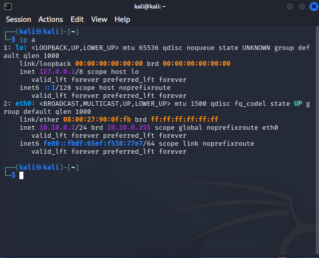

# Networkwalks Week 2: Footprinting & Network Scanning

This repository has my Week 2 footprinting and scanning report, the outputs of the commands I ran, and the screenshots I took. It is my submission for the Cybersecurity & Ethical Hacking program at Networkwalks (Batch B082).

In this week I did two practical tasks:

1. **W2-PM1, Footprinting:** I collected public information about the `networkwalks.com` domain with different Kali Linux tools. I had written permission for this target.
2. **W2-PM5, Network scanning:** I used Zenmap to run a ping scan on my own lab network and saved the topology.

## What is in this repo

| What | Where |
|---|---|
| **Report** (start here) | [W2-PM-FINAL_Pentest_Report.docx](W2-PM-FINAL_Pentest_Report.docx) |
| **Command outputs** | [outputs/](outputs/) |
| **Screenshots** | [screenshots/](screenshots/) |

```
.
├── W2-PM-FINAL_Pentest_Report.docx
├── outputs/
│   ├── task1_whois.txt
│   ├── task2_whatweb.txt
│   ├── task3_nslookup.txt
│   ├── task4_curl.txt
│   └── task5_wafw00f.txt
└── screenshots/
    ├── ip_a.png
    ├── zenmap_ping_scan.png
    └── zenmap_topology.pdf
```

## Tools I used

| Tool | What I used it for | Output |
|---|---|---|
| whois | Domain registration details | [task1_whois.txt](outputs/task1_whois.txt) |
| whatweb | Website technologies | [task2_whatweb.txt](outputs/task2_whatweb.txt) |
| nslookup | Finding the IP address | [task3_nslookup.txt](outputs/task3_nslookup.txt) |
| curl -I | HTTP response headers | [task4_curl.txt](outputs/task4_curl.txt) |
| wafw00f | Checking for a web application firewall | [task5_wafw00f.txt](outputs/task5_wafw00f.txt) |
| Zenmap (Nmap) | Finding live hosts on the local network | [zenmap_ping_scan.png](screenshots/zenmap_ping_scan.png) |
| ip a | Checking my own IP and MAC address | [ip_a.png](screenshots/ip_a.png) |

## Main things I found

- The website runs on **WordPress 7.1.5** with the **WordPress Download Manager 3.3.79** plugin.
- The domain resolves to **192.232.216.135**.
- The site is protected by **ModSecurity (SpiderLabs)**.
- The domain is registered with GoDaddy and uses HostGator name servers. DNSSEC is not signed.
- The Zenmap ping scan said that all 256 addresses of `10.0.0.0/24` were up. My lab is a virtual network, so I do not think all of them are real devices.

More detail, the risk table and my recommendations are in the report.

## Screenshots

**My IP address on Kali (`ip a`)**



**Zenmap ping scan (`nmap -sn 10.0.0.0/24`)**


The topology saved from Zenmap is here: [zenmap_topology.pdf](screenshots/zenmap_topology.pdf). It looks crowded because all 256 addresses answered.

## Disclaimer

I only tested systems where I had written permission or devices that I own. This work is for education only and no exploitation was done.

**Author:** Shahzaib Memon
