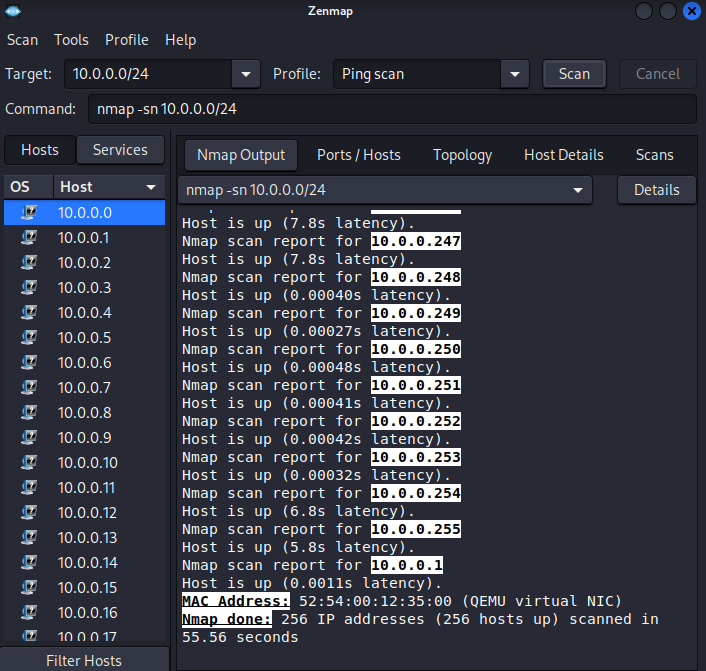

# NetworkWalks-Week-2
completed NetworkWalks Internship week 2 project work (footprinting and network scanning)

Full report: [W2-PM-FINAL_Pentest_Report.docx](W2-PM-FINAL_Pentest_Report.docx)

Week 1 repo (lab setup): [NetworkWalks-Week-1](https://github.com/shahzaib227/NetworkWalks-Week-1)

# Lab used for this week

I used the same Kali Linux virtual machine and the VirtualBox NAT Network that I set up in Week 1 (NatNetwork, 10.0.0.0/24). The footprinting was done on `networkwalks.com` (I have permission) and the scanning was done on my own lab network only.

# Footprinting: whois

Command: `whois networkwalks.com`

Domain is registered with GoDaddy, created on 2019-11-06 and expires on 2027-11-06. Name servers are HostGator and DNSSEC is unsigned.

Full output: [task1_whois.txt](outputs/task1_whois.txt)

# Footprinting: whatweb

Command: `whatweb networkwalks.com`

Apache server, WordPress 7.1.5 and WordPress Download Manager 3.3.79. IP is 192.232.216.135.

Full output: [task2_whatweb.txt](outputs/task2_whatweb.txt)

# Footprinting: nslookup

Command: `nslookup networkwalks.com`

```
Non-authoritative answer:
Name:	networkwalks.com
Address: 192.232.216.135
```

# Footprinting: curl

Command: `curl -I https://networkwalks.com`

The headers show the WordPress REST API link (`/wp-json/`), cache headers and a `__wpdm_client` cookie.

Full output: [task4_curl.txt](outputs/task4_curl.txt)

# Footprinting: wafw00f

Command: `wafw00f https://networkwalks.com`

```
[+] The site https://networkwalks.com is behind ModSecurity (SpiderLabs) WAF.
[~] Number of requests: 2
```

# Checked my IP address on Kali

Command: `ip a`


# Zenmap ping scan

Command: `nmap -sn 10.0.0.0/24`



The scan said 256 hosts are up. I do not think all of them are real devices because this is a virtual network.

# Zenmap topology

Saved from the Topology tab with the legend on: [zenmap_topology.pdf](screenshots/zenmap_topology.pdf)

It looks crowded because all 256 addresses answered.

# Disclaimer

I only tested systems where I had written permission or devices that I own. This is for education only and no exploitation was done.

End
